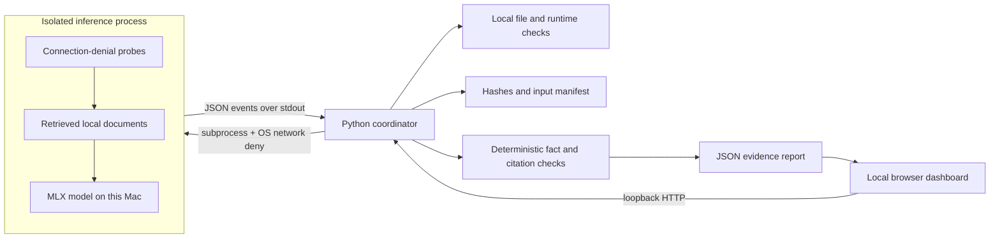

# Scout Offline Proof

**A model on disk is a starting point. A completed task with network access denied is evidence.**

A standalone local companion to A1 Scout, built during the October 2026 AITX / MLOps hackathon. It checks a local MLX setup, runs configurable acceptance tasks under macOS network denial, validates the outputs, and exports an evidence report.

## Run the dashboard

macOS on Apple silicon; Python 3.10 or newer. The dashboard and harness use the standard library only.

```sh
python3 -m proof serve
```

Open <http://127.0.0.1:8741>. Choose a task suite and **Local model** for actual MLX inference, or **Harness check** to test the pipeline without a language model. The harness is labeled separately and can never earn **Verified offline**. The dashboard keeps your settings on this browser and uses Scout's charcoal/yellow palette, IBM Plex typography, and compact cards. Dark and light themes are available; fonts are served locally.

For real inference, use an existing MLX Python environment, or prepare one while online:

```sh
uv venv --python 3.12 .venv
uv pip install --python .venv/bin/python -r requirements.lock
```

Select a local MLX text model directory containing `config.json`, a tokenizer, and its safetensors weights. Auto-discovery checks `/Volumes/A1/stash/models/mlx` and `.proof/models`. You can enter another path in the dashboard. Weights are never downloaded, edited, or deleted by this app.

Run from the CLI:

```sh
python3 -m proof check --model /path/to/local/model --python .venv/bin/python
python3 -m proof suites
python3 -m proof run --suite all --model /path/to/local/model --python .venv/bin/python --output reports/proof.json
python3 -m proof run --mode harness --suite all --output reports/harness.json
```

No API keys, environment secrets, accounts, cloud service, or `.env` file are needed. Offline runs set `HF_HUB_OFFLINE=1`, `TRANSFORMERS_OFFLINE=1`, and disable telemetry. **The OS policy provides enforcement; environment variables alone do not.**

## Task suites and failure scenarios

| Suite ID | Tasks | Acceptance criteria |
| --- | ---: | --- |
| `fieldkit-qa` | 3 | Expected facts, source filename, verbatim supporting quotation, and abstention |
| `extraction` | 3 | Exact JSON fields, scalar types, values, missing information as null, and ignoring an injected instruction |
| `tool-routing` | 4 | Allowed tool name, exact arguments, requesting a missing argument, and refusing an unsupported action |
| `all` | 10 | All three suites, with separate category scores |

Tool selection is a contract test: **proposed calls are never executed**. The supplied examples are synthetic and small; passing does not establish general agent safety.

The recommended **Failure replay** tests the evaluator's decisions. Every task supplies a valid control plus known invalid responses. For agent tool selection, the four tasks become 32 cases: four responses that should be accepted and 28 that should be rejected. These include invented tools, missing/extra arguments, wrong argument types and values, and an allowed tool chosen for the wrong request. Across all three suites, replay runs 63 cases.

Replay reports **cases verified**, valid responses accepted, invalid responses rejected, false accepts, and false rejects. A replay case passes when the evaluator's decision matches the expected verdict—even when that verdict is rejection. Any mismatch fails the harness. Automated tests deliberately replace the evaluator with always-accept and always-reject implementations to ensure replay catches both defects. Replay cannot earn **Verified offline**.

```sh
python3 -m proof run --mode harness --suite tool-routing --harness-case failure-replay
python3 -m proof run --mode harness --suite all --harness-case failure-replay
```

The simpler fixture scenarios are also available:

```sh
python3 -m proof run --mode harness --suite all --harness-case valid
python3 -m proof run --mode harness --suite all --harness-case wrong-answer
python3 -m proof run --mode harness --suite all --harness-case malformed-json
```

For the bundled suites, `valid` produces `harness_passed` and exit 0. Both fault scenarios deliberately produce failed tasks, `failed` status, and exit 1. A failure here demonstrates that the evaluator catches the injected faults; it is not an inference result. Custom suites replay your supplied fixtures, so inspect their actual scores and fault results rather than assuming a fixture is correct. `--harness-case` has no effect on real model outputs.

### Where the decision model fits

In the tool-selection suite, the local language model acts as a decision model: it receives a request and tool contracts, then proposes an action with arguments, requests clarification, or selects no action. The evaluator applies explicit acceptance criteria to that proposal. Harness replay checks the evaluator using prepared decisions; real inference checks the model's actual decisions under OS network denial. No second language model judges the outputs, and the proposed actions are not executed in this release.

## Configure your own tasks

Copy one of `data/suites/*.json`, then select **Custom JSON file** in the dashboard or pass its path using `--suite`. Set the documents directory under **Local paths** or with `--documents` for grounded Q&A. Extraction and tool-selection tasks carry their input text in the suite and do not need a document directory.

This minimal custom suite extracts a typed record:

```json
{
  "schema_version": 1,
  "id": "my-records",
  "name": "My record extraction",
  "description": "Extract an ID and an integer count.",
  "max_tokens": 200,
  "tasks": [{
    "id": "record-count",
    "kind": "json_exact",
    "question": "Extract record_id and count. Use an integer for count.",
    "input": "Record A-17 contains 6 observations.",
    "fields": {"record_id": "string", "count": "integer"},
    "expected": {"record_id": "A-17", "count": 6},
    "fixture": {"record_id": "A-17", "count": 6}
  }]
}
```

```sh
python3 -m proof check --mode harness --suite /path/to/my-suite.json
python3 -m proof run --suite /path/to/my-suite.json --model /path/to/model --python .venv/bin/python
```

Each suite has 1–50 uniquely identified tasks and is at most 512 KB. `max_tokens` is an integer from 32 to 1024 (default 200); `retrieval_limit` is 1–5 (default 2). Each task has an `id`, `kind`, `question` (the instruction), and explicit `fixture` object for harness mode:

- `grounded_qa`: `answerable`, `expected` fact strings, and `source` filename. Unanswerable tasks use `expected: []` and `source: null`; output must abstain with `NOT_FOUND` and null source/quote.
- `json_exact`: `input` text, `fields` mapping names to types, and `expected` object. Supported types are `string`, `integer`, `number`, `boolean`, and `null`; unions such as `string|null` allow either. Fields are flat scalar values; nested extraction schemas are not supported. Exact-value grading also distinguishes integer and floating-point values.
- `tool_call`: `input`, `tools` contracts (each with `name`, `description`, and an `arguments` field/type mapping), and `expected: {"tool": "…", "arguments": {…}}`. Unknown tools, extra or missing arguments, wrong types, and wrong values fail.

Extraction and tool-call outputs must be bare JSON objects: duplicate keys, nonstandard constants, Markdown fences, and trailing prose fail. The original Q&A parser also accepts fenced JSON and strips thinking tags. Grading targets and fixtures are removed from real-model payloads; only instructions, inputs, retrieval context, and output contracts reach the model. A suite or corpus edited during a run invalidates that run. Suite files are data only; executable validators are unsupported.

## What happens

1. **Preflight:** validate the task suite, interpreter, required local documents, model folder, tokenizer, weights/index, MLX installation, model size budget, and sandbox availability.
2. **Fingerprint:** SHA-256 the documents, task bank, application source, and model assets. The model is read-only. Confirm sizes and modification times are stable when the run ends.
3. **Isolate:** launch the runner under `sandbox-exec` with `(deny network*)`. Test a known-reachable local TCP witness, external IPv4 TCP, IPv6 TCP, and UDP. Only `EPERM`/`EACCES` count as denial; timeouts and connection refusal fail the proof.
4. **Execute:** retrieve documents for Q&A tasks, load the model once, and execute the selected tasks sequentially with greedy decoding. No gold answers are sent to the language model.
5. **Verify:** apply each task's validator: facts, quotations and abstention; exact typed extraction; or tool-selection contracts. Reports include the suite definition hashes, generation settings, and expected values alongside actual outputs.

All generated answers, checks, timings, runtime versions, machine identity, network evidence, and hashes go in the JSON report. Reports are stored under `.proof/reports` (Git-ignored). The local UI polls only the loopback coordinator. Runs have a five-minute timeout, and the dashboard permits one run at a time.

## Architecture



Technology: Python standard library, MLX / mlx-lm, plain HTML/CSS/JavaScript. The coordinator and UI have no remote dependencies. Code is independent of Scout's private service and does not read Scout credentials.

## Data and model provenance

- `data/fieldkit/*.md`: three original synthetic documents written for this project on October 28, 2026. FieldKit is fictional. No customer data or session history is used.
- `data/suites/*.json`: original acceptance suites and explicit harness fixtures. All field records and requests are synthetic; they contain no customer data.
- Model weights are supplied by the operator. The first target is [`mlx-community/Qwen3-1.7B-4bit`](https://huggingface.co/mlx-community/Qwen3-1.7B-4bit), an existing model from the A1 stash. The report identifies the actual files by SHA-256; it does not infer a Hub revision from a folder name.
- External dependency versions are pinned in `requirements.lock`. Model weights and virtual environments are excluded from Git.
- `web/fonts/`: IBM Plex Mono and Sans Latin fonts, redistributed under the SIL Open Font License in `web/fonts/LICENSE.txt`. Obtained from Google Fonts; they are served locally, including during offline demonstrations.
- No private Scout application code was copied. Relationship to Scout is documented in `PLAN.md`. Check hackathon rules with the organizers for pre-existing models and third-party dependencies; this repository does not establish eligibility by itself.

## Verification

```sh
python3 -m unittest discover -s tests -v
node --check web/app.js
```

Tests exercise unsupported sources, invented quotations, wrong facts, abstention, typed extraction, tool-contract violations, malformed suites and outputs, grading-data separation, missing assets, real macOS network isolation, timeouts, input changes, request authorization, and the distinction between harness results and model proofs.

## Limits and next steps

- **Scope:** the runner and its descendants are network-denied. The Mac, SSH/Tailscale connection, and dashboard remain online. This is not an air-gap certification or a general security sandbox.
- **Quality:** the ten bundled synthetic tasks are a narrow acceptance test. Exact facts and quotations cannot establish that every extra sentence is true. Add domain-specific suites before relying on this for real work.
- **Platform:** macOS / Apple silicon with `sandbox-exec`. This OS facility is deprecated; availability is checked and unsupported systems fail closed. Linux/container isolation is future work.
- **Corpus:** UTF-8 `.md`/`.txt`, at most 100 files / 2 MB, configurable top 1–5 documents, each limited to 7,000 characters. The bundled Q&A criteria belong to FieldKit; unrelated documents need a matching custom suite. PDF ingestion is future work.
- **Resources:** one model per run, model weights below 70% of physical memory, and a suite-defined token budget. Actual memory overhead can exceed the weight size. Choose a small model on shared machines.
- **Reports:** local, unsigned records containing machine names and file paths. Inspect/redact them before publishing. They support debugging and reproducibility, not third-party attestation.
- Next: record model revision provenance, compare model revisions, expand validators, and integrate a results view with the native Scout app.

See `DEMO.md` for the live walkthrough and `SUBMISSION.md` for the draft event write-up.
