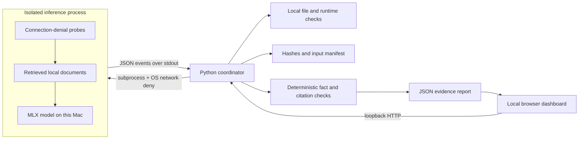

# Scout Offline Proof

**A model on disk is a starting point. A completed task with network access denied is evidence.**

A standalone local companion to A1 Scout, built during the October 2026 AITX / MLOps hackathon. It checks a local MLX setup, runs a document-answering workflow under macOS network denial, checks the answers, and exports a reproducible evidence report.

## Run the dashboard

macOS on Apple silicon; Python 3.10 or newer. The dashboard and harness use the standard library only.

```sh
python3 -m proof serve
```

Open <http://127.0.0.1:8741>. Choose **Local model** for actual MLX inference, or **Harness check** to test the pipeline without a language model. The harness is labeled separately and can never earn **Verified offline**.

For real inference, use an existing MLX Python environment, or prepare one while online:

```sh
uv venv --python 3.12 .venv
uv pip install --python .venv/bin/python -r requirements.lock
```

Select a local MLX text model directory containing `config.json`, a tokenizer, and its safetensors weights. Auto-discovery checks `/Volumes/A1/stash/models/mlx` and `.proof/models`. You can enter another path in the dashboard. Weights are never downloaded, edited, or deleted by this app.

Run from the CLI:

```sh
python3 -m proof check --model /path/to/local/model --python .venv/bin/python
python3 -m proof run --model /path/to/local/model --python .venv/bin/python --output reports/proof.json
python3 -m proof run --mode harness --output reports/harness.json
```

No API keys, environment secrets, accounts, cloud service, or `.env` file are needed. Offline runs set `HF_HUB_OFFLINE=1`, `TRANSFORMERS_OFFLINE=1`, and disable telemetry. **The OS policy provides enforcement; environment variables alone do not.**

## What happens

1. **Preflight:** validate the interpreter, local documents, model folder, tokenizer, weights/index, MLX installation, model size budget, and sandbox availability.
2. **Fingerprint:** SHA-256 the documents, task bank, application source, and model assets. The model is read-only. Confirm sizes and modification times are stable when the run ends.
3. **Isolate:** launch the runner under `sandbox-exec` with `(deny network*)`. Test a known-reachable local TCP witness, external IPv4 TCP, IPv6 TCP, and UDP. Only `EPERM`/`EACCES` count as denial; timeouts and connection refusal fail the proof.
4. **Execute:** retrieve the two closest documents by deterministic lexical overlap, load the model once, and answer three questions sequentially with greedy decoding. No gold answers are sent to the language model.
5. **Verify:** validate JSON output, expected facts, expected source filenames, exact supporting quotations, and explicit abstention on a question the corpus cannot answer.

All generated answers, checks, timings, runtime versions, machine identity, network evidence, and hashes go in the JSON report. Reports are stored under `.proof/reports` (Git-ignored). The local UI polls only the loopback coordinator. Runs have a five-minute timeout, and the dashboard permits one run at a time.

## Architecture



Technology: Python standard library, MLX / mlx-lm, plain HTML/CSS/JavaScript. The coordinator and UI have no remote dependencies. Code is independent of Scout's private service and does not read Scout credentials.

## Data and model provenance

- `data/fieldkit/*.md`: three original synthetic documents written for this project on October 28, 2026. FieldKit is fictional. No customer data or session history is used.
- `data/tasks.json`: original three-question evaluation bank: retention, checksum algorithm, and an unsupported price question.
- Model weights are supplied by the operator. The first target is [`mlx-community/Qwen3-1.7B-4bit`](https://huggingface.co/mlx-community/Qwen3-1.7B-4bit), an existing model from the A1 stash. The report identifies the actual files by SHA-256; it does not infer a Hub revision from a folder name.
- External dependency versions are pinned in `requirements.lock`. Model weights and virtual environments are excluded from Git.
- No private Scout application code was copied. Relationship to Scout is documented in `PLAN.md`. Check hackathon rules with the organizers for pre-existing models and third-party dependencies; this repository does not establish eligibility by itself.

## Verification

```sh
python3 -m unittest discover -s tests -v
node --check web/app.js
```

Tests exercise unsupported sources, invented quotations, wrong facts, abstention, missing assets, real macOS network isolation, timeouts, changed corpus failures, request authorization, and the distinction between harness results and model proofs.

## Limits and next steps

- **Scope:** the runner and its descendants are network-denied. The Mac, SSH/Tailscale connection, and dashboard remain online. This is not an air-gap certification or a general security sandbox.
- **Quality:** passing three synthetic tasks is a narrow acceptance test. Exact facts and quotations cannot establish that every extra sentence is true. Add domain-specific task banks before relying on this for real work.
- **Platform:** macOS / Apple silicon with `sandbox-exec`. This OS facility is deprecated; availability is checked and unsupported systems fail closed. Linux/container isolation is future work.
- **Corpus:** UTF-8 `.md`/`.txt`, at most 100 files / 2 MB, top two documents, each limited to 7,000 characters. This release's pass criteria belong to the bundled FieldKit benchmark; pointing it at unrelated documents should fail. PDF ingestion and custom evaluation authoring are future work.
- **Resources:** one model per run, model weights below 70% of physical memory, 200 output tokens per question. Actual memory overhead can exceed the weight size. Choose a small model on shared machines.
- **Reports:** local, unsigned records containing machine names and file paths. Inspect/redact them before publishing. They support debugging and reproducibility, not third-party attestation.
- Next: record model revision provenance, author custom acceptance tasks, compare model revisions, and integrate a results view with the native Scout app.

See `DEMO.md` for the live walkthrough and `SUBMISSION.md` for the draft event write-up.
